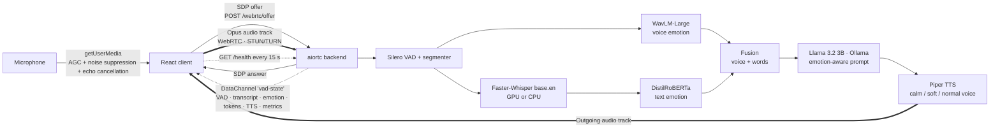

# Auralis — Frontend

**Real-time Voice-to-Voice (V2V) Emotion Engine: browser client.**

A React + native WebRTC dashboard that streams live microphone audio to the Auralis backend and shows, in real time, what the system heard, which emotion it detected (from the voice and from the words), how Auralis replies and **speaks back in a matching tone**, and how long every step took.

Part of Infotact Solutions' *Advanced Generative AI Engineering* internship (Project 2).

| Role | Owner | Branch |
|---|---|---|
| **Frontend: WebRTC client + live dashboard (this module)** | Ankit Dash | `frontend` |
| Backend: WebRTC, VAD, STT, emotion fusion, LLM + TTS streaming | Priya Nirmal | `Backend` |
| ML: emotion recognition, fusion, TTS research | Siddhant (Weeks 1–2), Ankit Dash + Priya Nirmal (Week 3) | `ML` |

---

## Why Auralis

Most conversational AI chains **Speech-to-Text → LLM → Text-to-Speech** over slow request/response calls, adding 3–5 s of delay and discarding the speaker's tone. Auralis streams audio continuously over WebRTC, detects when the user stops speaking, transcribes it, **detects the emotion**, and streams a reply from a local LLM that is **spoken back sentence by sentence** in a voice style matched to that emotion. The target is **sub-800 ms** voice responses.

**Use case:** a Crisis Negotiation Training Simulator, where a trainee speaks under pressure and the AI de-escalates in a tone matched to their emotional state.

---

## Architecture (end of Week 3)



- **Signalling:** one HTTP exchange (offer → answer). After that, everything flows over the peer connection.
- **Audio both ways:** the mic goes up as a WebRTC media track; Auralis's voice comes back as a second track (UDP, low latency).
- **Results:** VAD state, transcripts, emotions, streamed LLM tokens, TTS progress and per-turn timings come back over a WebRTC **DataChannel**, so the UI never polls for them.
- **Status:** `/health` is the only polled endpoint; it tells the UI which models and devices the backend runs.

---

## Features

### Week 3 (new)

| Feature | What it does |
|---|---|
| **AI voice playback** | Plays Auralis's spoken reply from the backend audio track; live packet counter from WebRTC stats; recovery button if the browser blocks autoplay |
| **AI speaking state** | VAD panel shows `AI SPEAKING` while Auralis talks; **TTFA** card (speech end → first AI audio), voice-style badge (calm / soft / normal) on each reply |
| **Echo filter display** | Counts speech the backend ignored while Auralis was talking, so the AI never answers itself |
| **Emotion badges** | Every user turn shows the detected emotion, its confidence and group (upset / low / okay); guesses below 60 % are shown as *neutral* with the raw guess in brackets |
| **Voice vs words** | Each badge shows the **voice** guess (WavLM), the **words** guess (text model) and **which one decided** the final emotion |
| **Emotion Test Mode** | Pick the emotion you are acting, speak, and the panel scores final / voice-only / words-only accuracy with a confusion grid; CSV export |
| **Latency breakdown** | Per-turn stacked bar: speech → text · Llama thinking · first phrase written · voice synthesis; p50 / p95 first audio; slowest stage |
| **Live backend status** | `BACKEND ONLINE · n ms` / offline badge from `/health` every 15 s; only a real Auralis reply counts as online |
| **System chips** | STT model + device (cpu / cuda), GPU name, voice-emotion model, words on/off, TTS engine, LLM model, straight from `/health` |
| **Latency audit · compare machines** | Save the current turns as a named run (e.g. *Ankit GPU*, *Priya CPU*), compare runs side by side against the 800 ms target, export CSV; runs are kept in this browser |

### Weeks 1–2

| Feature | What it does |
|---|---|
| **WebRTC connection** | Offer/answer signalling, STUN + TURN (from `.env`), ICE gathering with early exit on a relay candidate and a 3 s cap |
| **Mic capture + level meter** | Browser AGC, noise suppression, echo cancellation; Web Audio `AnalyserNode` → dB at 60 fps, written straight to the DOM |
| **Voice activity display** | Live SPEAKING → PROCESSING → IDLE from the backend's Silero VAD |
| **Conversation panel** | Chat bubbles; the reply **types in live, token by token**; STT time, TTFT and total time badges |
| **Latency dashboard** | Speech → Text, TTFT, full reply time, colour-coded against the 800 ms target |
| **Transcription audit** | Per-segment speech duration, silence wait, transcribed vs empty |
| **Connection diagnostics + event log** | ICE candidate types, why gathering ended, connect time; last 30 meaningful events |
| **Error handling** | Denied/missing mic, missing config, 404, 403 (CORS), unreachable backend, blocked autoplay, LLM / TTS errors |
| **Performance** | Frame counter throttled (50 msgs/s → 5 renders/s); FIFO segment ↔ transcript queue |

---

## DataChannel protocol

The frontend opens a DataChannel labelled `vad-state`. The backend sends JSON messages:

| `type` | Main fields | Frontend behaviour |
|---|---|---|
| `status` | `status` | Updates the status card |
| `audio_frame` | `frame, is_speech, segment_started, segment_finished, …` (~50/s) | Frame counter + segment tracking; never logged |
| `vad` | `vad_state`: `speaking` \| `processing` \| `idle` \| `ai_speaking` | Updates the VAD badge |
| `transcript` | `text, stt_ms` | Adds a new conversation turn, records STT latency |
| `emotion` | `label, confidence, group, confident, ms, source, voice_label, voice_confidence, text_label, text_confidence, text_ms` | Emotion badge on the turn, emotion card, test-mode scoring |
| `llm_start` | — | "Thinking" dots in the AI bubble |
| `llm_token` | `text, first, ttft_ms` *(first only)* | Appends to the AI bubble; records **TTFT** |
| `llm_done` | `text, ttft_ms, total_ms, tokens` | Finalises the bubble |
| `tts_start` | `ttfa_ms, style` | Voice badge + **TTFA** |
| `tts_sentence` | `index, audio_ms` | Counts spoken sentences |
| `tts_end` | `sentences, audio_ms, underruns` | Marks the reply as spoken |
| `turn_metrics` | `stt_ms, emotion_ms, ttft_ms, first_piece_ms, ttfa_ms, first_synth_ms, total_ms, voice` | One row in the latency breakdown |
| `echo_ignored` | — | Increments the echo counter |
| `llm_error` / `tts_error` / `audio_error` | `error` | Shows / logs the error |

**One turn:** `vad: speaking` → `vad: processing` → `transcript` → `emotion` → `llm_start` → `llm_token` × N → `tts_start` → `tts_sentence` × N → `llm_done` → `tts_end` → `turn_metrics` → `vad: idle`

All timings are measured by the backend **from the moment the VAD detects end of speech**, so network delay doesn't distort them.

---

## Week 3 results

### Emotion: voice vs words (Emotion Test Mode, 7 acted turns)

| Source | Accuracy |
|---|---|
| Voice only (WavLM-Large, adapted) | 29 % |
| Words only (DistilRoBERTa) | 71 % |
| **Final, fused (shown to the user)** | **71 %** (3-group 86 %) |

Example: *"I'm very sad today"*, voice said neutral 93 %, words said sad 99 %, so the final emotion is **sad** (decided by the words).
In free conversation, *"I say stop."* came out as **angry** (words 68 %), and Auralis answered in the **calm voice**: *"It sounds like you're feeling really overwhelmed right now. Can you take a deep breath…"*

### Latency (Latency Audit, 10 turns, Ankit's laptop, backend on localhost)

| Stage | Average |
|---|---|
| Speech → text (Whisper `base.en`, CPU) | 2,557 ms |
| Llama thinking (Llama 3.2 3B, RTX 2050) | 1,705 ms |
| First phrase written | 644 ms |
| Voice synthesis (Piper) | 1,117 ms |
| **First audio, p50 / p95** | **4,781 ms / 13,326 ms** (6× the 800 ms target) |

- **Slowest stage: speech → text.** Whisper was still on the CPU in this run; the Week 3 Day 6 backend can move it to the GPU (`nvidia-cublas-cu12` + `nvidia-cudnn-cu12`), which is the next big saving.
- Long sentences cost the most: one 25-word question took 7.4 s just to transcribe.
- The same pipeline on a CPU-only laptop reached the first audio in roughly 7–8 s; the Latency Audit card is built to record these runs side by side.

---

## Getting started

**Prerequisites:** Node.js 18+, and the Auralis backend running (see the `Backend` branch).

```bash
git clone https://github.com/Ankit-builds1/Auralis.git
cd Auralis
git checkout frontend
cd frontend
npm install
```

### Pick the backend with Vite modes

Env files live in `frontend/` (next to `package.json`, **not** in `src/`). They are gitignored, so never commit them.

| File | Used by | Example |
|---|---|---|
| `.env` | `npm run dev` | `VITE_BACKEND_URL=http://localhost:8001` (backend on this machine) |
| `.env.priya.local` | `npm run dev -- --mode priya` | `VITE_BACKEND_URL=https://<teammate>.ngrok-free.dev` (a teammate's backend via ngrok) |

Optional TURN settings (only needed across different networks):

```env
VITE_TURN_URL=turn:<turn-server>:80
VITE_TURN_USERNAME=<username>
VITE_TURN_CREDENTIAL=<password>
```

On Windows PowerShell, create the files with plain encoding, and without a trailing `/` in the URL:

```powershell
Set-Content -Path .env -Value "VITE_BACKEND_URL=http://localhost:8001" -Encoding ascii
Set-Content -Path .env.priya.local -Value "VITE_BACKEND_URL=https://<teammate>.ngrok-free.dev" -Encoding ascii
```

Run:

```bash
npm run dev                    # own backend   -> http://localhost:5173
npm run dev -- --mode priya    # teammate's backend
```

**Usage:** START MIC → CONNECT → wait for ICE State `connected` → speak, then pause. The system chips show which backend (CPU / GPU) you are talking to.

---

## Troubleshooting

| Symptom | Cause | Fix |
|---|---|---|
| "Backend URL is not configured" | `.env` missing or not loaded | Create `frontend/.env`, then restart `npm run dev` (Vite reads env files only at startup) |
| Request goes to `.../undefined/webrtc/offer` | `.env` in the wrong folder | Put it in `frontend/`, not `src/` |
| `.env` exists but URL is still `undefined` | PowerShell `>` writes UTF-16 | Recreate with `Set-Content ... -Encoding ascii` |
| Requests go to `...dev//health` | Trailing `/` in `VITE_BACKEND_URL` | Remove the final `/` |
| `BACKEND OFFLINE` although ngrok is up | ngrok points to another app, or the backend is stopped | ngrok must forward to the Auralis backend port (`8001`); start the backend |
| `403` / CORS error | Dev server on a port other than 5173/5174 | Close old `npm run dev` terminals and restart |
| AI bubble shows "⚠ Cannot reach Ollama" | Ollama not running on the backend machine | Start Ollama (`ollama serve`); if the models were moved, set `OLLAMA_MODELS` to the new folder first |
| `ollama list` → "timed out waiting for server to start" | Ollama stuck looking for a moved models folder | Stop `ollama*` processes, set `OLLAMA_MODELS`, run `ollama serve` |
| STT chip says `cpu` on a GPU machine | CUDA libraries for faster-whisper missing | In the backend venv: `pip install nvidia-cublas-cu12 "nvidia-cudnn-cu12==9.*"`, restart the backend |
| No AI voice, packets counting | Browser blocked autoplay | Click the audio recovery button |
| Works on the same Wi-Fi, fails across networks | Free public TURN server unreliable | Use a dedicated TURN server |

---

## Final demo checklist (end of Week 3)

**Setup (before the call)**
- [ ] `ollama serve` running with `llama3.2:3b`
- [ ] Backend shows `[STARTUP] Ready` (STT device `cuda` if available)
- [ ] Frontend running; `BACKEND ONLINE` and all system chips visible
- [ ] Conversation, Emotion Test Mode and latency turns cleared; saved audit runs kept

**Live demo (~6 minutes)**
1. **Status:** show `BACKEND ONLINE` and the system chips (models, GPU, devices).
2. **Connect:** START MIC → CONNECT; ICE `connected`, mic meter in the green zone.
3. **Conversation:** *"Hello, who's this?"*; show the transcript, the reply typing in, and **Auralis speaking it** (AI SPEAKING state, TTFA badge).
4. **Emotion → voice:** say something upset (*"I say stop!"*); show the **angry** badge, *by words*, and the **calm voice** reply.
5. **Voice vs words:** point at the voice guess, the words guess and which one decided.
6. **Emotion Test Mode:** pick *sad*, say *"I'm very sad today"*; show final / voice-only / words-only scoring.
7. **Echo filter:** show the echo counter; Auralis does not answer its own voice.
8. **Latency breakdown:** stacked bars, slowest stage, p50/p95 vs the 800 ms target.
9. **Compare machines:** saved runs (GPU vs CPU) side by side; explain the path to 800 ms.

**Evidence to keep:** screenshots of the conversation with emotion and voice badges, Emotion Test Mode results, latency breakdown, the audit table, and the exported CSVs.

---

## Progress log

### Week 1: WebRTC foundation ✅

| Day | Work |
|---|---|
| 1 | Vite + React scaffold, ESLint, microphone capture with `getUserMedia` |
| 2 | `RTCPeerConnection`, mic track attached, SDP offer generated |
| 3 | Offer sent to `/webrtc/offer`, answer applied, STUN/TURN configured |
| 4 | Remote audio playback via `ontrack`; round trip verified |
| 5 | Error handling for mic, configuration, HTTP and connection failures |

### Week 2: VAD, LLM & mid-project review ✅

| Day | Work |
|---|---|
| 1–3 | DataChannel (`vad-state`), VAD badge, transcripts, frame filtering |
| 4–5 | Speech → text latency check; transcription audit panel (exposed and helped fix 8 pipeline bugs) |
| 6 | Live mic level meter; faster ICE gathering; connection diagnostics |
| 7 | Documentation and demo checklist |
| + | Conversation panel with streamed LLM reply, TTFT metrics, UI polish |

### Week 3: emotion, voice & latency ✅

| Day | Work |
|---|---|
| 1 | AI audio track status, incoming packet counter, autoplay recovery button |
| 2 | Emotion badges on every turn, emotion card, low-confidence → neutral fallback |
| 3 | AI SPEAKING state, **TTFA** card, voice-style badges, echo-ignored counter |
| 4 | Latency breakdown panel: per-stage bars, p50 / p95, slowest stage |
| 5 | Voice vs words emotion badge (fusion source), **Emotion Test Mode** with confusion grid + CSV |
| 6 | Live backend status + system chips from `/health`; **Latency Audit** to compare machines (CPU vs GPU) + CSV |
| 7 | Health-check fix (only a real Auralis reply counts as online), Vite modes to switch backends, this README and the final demo checklist |

---

## Known limitations

- **Latency is above the 800 ms target:** about 4.8 s to the first audio (p50) with Whisper on CPU; GPU Whisper and shorter replies are the next steps.
- **Long replies:** Llama sometimes answers in a full paragraph, which delays the end of the spoken reply.
- **Whisper `base.en`** mishears unusual terms and accents (e.g. "Gen AI" → "Genet API").
- **Voice-only emotion is weak on our voices** (~29–55 %); the words carry most of the signal, so the fused result is what the UI shows.
- **No barge-in yet:** speech while Auralis is talking is ignored (echo filter) rather than interrupting it.
- **Free public TURN server** is unreliable across networks; **ngrok** adds delay when using a remote backend.
- Saved audit runs live in the browser's `localStorage` (export CSV to keep them).

---

## Roadmap (Week 4: Refine & Polish)

- Interruption handling (barge-in): stop Auralis's voice as soon as the user speaks
- Waveform visualiser for user and AI audio; emotion-driven colour shifts
- Dedicated TURN server for cross-network demos
- Final latency runs with GPU Whisper

---

## Tech stack

React 19 · Vite 8 · native WebRTC (`RTCPeerConnection`, `RTCDataChannel`, `getUserMedia`, `getStats`) · Web Audio API (`AnalyserNode`) · `localStorage` · ESLint

## Project structure

```
frontend/
├── src/
│   ├── App.jsx            # WebRTC client, DataChannel protocol, emotion + voice + latency panels, audit
│   ├── App.css            # "Midnight Aurora" theme and layout
│   ├── ui-polish.css      # Bubbles, badges, chips, test grid, audit table
│   └── main.jsx
├── .env                   # own backend URL (+ TURN), not committed
├── .env.priya.local       # teammate's backend URL, not committed
├── package.json
└── vite.config.js
```
