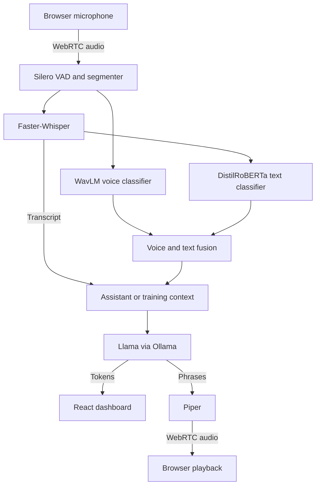

<div align="center">

# 🎙️AURALIS

### Real-Time Voice-to-Voice Emotion Engine

*Speak naturally. Auralis listens, understands what you said **and how you said it**, and talks back, in real time.*


**Infotact Solutions · Advanced Generative AI Engineering (Vol. II) · Project 2**

</div>

---

> **Final review update.** The diagrams show the integrated system. The mid-review measurements are retained for comparison. For the implemented Week 3–4 pipeline, demo walkthrough, and integrated source on `main`, jump to [What we added after the mid-review](#what-we-added-after-the-mid-review).

## 📌 Table of Contents

1. [The Problem](#-the-problem)
2. [What Auralis Does](#-what-auralis-does)
3. [System Architecture](#-system-architecture)
4. [How One Conversation Turn Works](#-how-one-conversation-turn-works)
5. [Tech Stack](#-tech-stack)
6. [Repository & Branch Structure](#-repository--branch-structure)
7. [Module Deep Dive](#-module-deep-dive)
8. [Real-Time Message Protocol](#-real-time-message-protocol)
9. [Measured Results (Mid-Project Review)](#-measured-results-mid-project-review)
10. [What we added after the mid-review](#what-we-added-after-the-mid-review)
11. [Getting Started](#-getting-started)
12. [Roadmap & Progress](#-roadmap--progress)
13. [Engineering Decisions & Trade-offs](#-engineering-decisions--trade-offs)
14. [Team](#-team)

---

## 🧩 The Problem

A basic voice assistant can process a turn in three stages:

```
Speech-to-Text  →  Text LLM  →  Text-to-Speech
```

This causes two problems:

| Problem | Effect |
|---|---|
| **High latency** | Waiting for a complete transcript and a complete reply delays the first audio. |
| **Lost emotion** | The LLM only reads text. A transcript alone omits vocal cues such as pitch and intensity. |

## 💡 What Auralis Does

Auralis is a **streaming, emotion-aware voice engine**. The target use case is a **Crisis Negotiation Training Simulator**: the trainee practises de-escalation while Auralis plays the distressed caller. The caller’s simulated agitation changes with the trainee’s words, tone, and interruptions.

- 🎧 **Streams microphone audio** to the backend over **WebRTC**
- 🗣️ **Estimates when a speaking turn ends** with Silero VAD
- 📝 **Transcribes** the sentence with Faster-Whisper
- 💭 **Classifies the emotion in your voice** using WavLM voice features and DistilRoBERTa transcript predictions
- 🤖 **Replies through a local Llama 3** with an "Auralis" persona, streamed **token by token**
- 🔊 **Speaks the reply** with Piper using a selected voice style, streamed back in audio chunks
- 📊 **Measures every step** live on the dashboard: STT latency, **TTFT**, full reply time, VAD segments

Model inference runs on the backend machine. The deployed frontend is hosted on Vercel and connects to that machine for live sessions.

---

## 🏗️ System Architecture



**Key design rule:** the audio **frame loop never waits** for Whisper or the LLM. VAD runs on every 20 ms frame, while transcription and the LLM reply run as **background tasks**. Audio keeps flowing, and the VAD keeps listening, even while Auralis is thinking.

---

## 🔁 How One Conversation Turn Works

```mermaid
sequenceDiagram
    autonumber
    participant U as 🧑 User
    participant F as Frontend
    participant B as Backend (VAD)
    participant W as Whisper
    participant L as Llama 3

    U->>F: Speaks into mic
    F->>B: Audio frames (WebRTC, 20 ms each)
    B-->>F: vad: speaking
    Note over B: ~700 ms of silence → end of speech
    B-->>F: vad: processing
    B->>W: Speech segment (background task)
    W-->>B: Transcript
    B-->>F: transcript + stt_ms
    Note over B,W: Voice classification runs alongside transcription
    B->>B: Combine transcript and voice emotion; update training state if active
    B->>L: Transcript, conversation history and mode context
    L-->>B: First token
    B-->>F: llm_token (first) + ttft_ms
    L-->>B: More tokens…
    B-->>F: llm_token × N (typed live in the UI)
    Note over B,F: Piper synthesises available phrases during generation
    B-->>F: Spoken audio over WebRTC
    B-->>F: llm_done + total_ms
    B-->>F: vad: idle
```

Turn latency uses the backend’s detected speech-end timestamp. First audio is timed on the backend; network and browser playback can add delay.

---

## 🛠️ Tech Stack

| Layer | Technology | Why |
|---|---|---|
| **Frontend** | React 19 + Vite 8 | Fast dev loop, simple state for a live dashboard |
| **Transport** | WebRTC (browser) ↔ **aiortc** (Python) | Low-latency UDP audio + a DataChannel for live events |
| **Signaling** | aiohttp `POST /webrtc/offer` | Exchanges SDP before WebRTC establishes a direct or relayed connection |
| **NAT traversal** | STUN + TURN (config in `.env`) | Discovers network paths and relays media when needed |
| **Voice Activity Detection** | **Silero VAD** (ONNX) | Accurate end-of-speech detection on 32 ms chunks |
| **Speech-to-Text** | **Faster-Whisper** `base.en` by default, configurable CPU or CUDA | Local, accurate English STT with prompt biasing |
| **LLM** | **Llama 3.2 3B** via **Ollama** | Local, streamed, with conversation memory |
| **Emotion** | WavLM Large + DistilRoBERTa | Combines acoustic and transcript predictions across six emotion labels |
| **TTS** | Piper | Synthesises styled speech in phrases while the LLM streams |

---

## 🌿 Repository & Branch Structure

The component branches were merged into `main`, which contains the integrated source and documentation.

| Branch | Owner | Contents |
|---|---|---|
| `main` | Team | `frontend/`, `Backend/`, `ml/`, and `docs/` |
| [`frontend`](https://github.com/Ankit-builds1/Auralis/tree/frontend) | **Ankit Dash** | `frontend/`: React dashboard, WebRTC client |
| [`Backend`](https://github.com/Ankit-builds1/Auralis/tree/Backend) | **Priya Nirmal** | `Backend/`: aiortc server, VAD, STT, LLM streaming |
| [`ML`](https://github.com/Ankit-builds1/Auralis/tree/ML) | **Siddhant** | `ml/`: emotion dataset, features, models, LLM prompts |

```
Auralis/
├── frontend/                       # branch: frontend
│   ├── src/App.jsx                 # WebRTC client, DataChannel handler, dashboard
│   ├── src/App.css                 # "Midnight Aurora" theme
│   └── src/ui-polish.css           # Conversation panel, metric styling
│
├── Backend/                        # branch: Backend
│   ├── app/main.py                 # aiohttp app, model warm-up at startup
│   ├── app/webrtc/                 # server.py · audio_track.py · tts_track.py
│   ├── app/audio/vad/detector.py   # Silero VAD (stateful resampler)
│   ├── app/audio/processor.py      # segmenting: pre-roll, hangover, min-voice filter
│   ├── app/stt/                    # transcriber.py · engine.py (shared Whisper)
│   ├── app/llm/ollama_client.py    # async streaming Llama client
│   └── tests/                      # pytest suite
│
└── ml/                             # branch: ML
    ├── src/features/               # MFCC, spectral, prosodic, temporal features
    ├── src/models/                 # training, tuning, inference
    ├── src/llm/                    # persona + emotion-aware prompts
    └── results/                    # confusion matrices, experiment logs
```

---

## 🔬 Module Deep Dive

<details>
<summary><b>🎙️ Frontend: WebRTC client & live dashboard</b> (Ankit)</summary>

<br/>

- **Mic capture** with browser echo cancellation, noise suppression and auto-gain (stronger, cleaner signal for VAD and Whisper)
- **WebRTC handshake** with smart ICE gathering: stops early once a TURN relay candidate is ready, with a 3 s timeout
- **Live mic level meter** (dB), updated through refs at 60 fps without re-rendering React
- **Conversation panel:** your sentence and Auralis's reply as chat bubbles, with the reply **typed live token by token**
- **Latency dashboard:** Speech→Text, **TTFT**, average TTFT, full reply time, colour-coded against the 800 ms target
- **Transcription Audit:** every VAD segment with speech length, silence wait, gap before, and whether it was transcribed
- **AI audio status:** detects the remote audio track, packet counter, autoplay-blocked recovery
- Performance-safe: frame counter throttled (50 msgs/s → 5 renders/s); segment↔transcript matching via a FIFO queue

</details>

<details>
<summary><b>⚙️ Backend: streaming pipeline</b> (Priya)</summary>

<br/>

- **aiortc server**: receives the browser's mic track, sends an outgoing audio track (for TTS) and a DataChannel
- **Silero VAD**: 48 kHz → 16 kHz with a **stateful** resampler (no clicks at frame edges); threshold 0.5; start after 3 speech chunks (~96 ms), end after 22 silence chunks (~700 ms)
- **Segmenter**: 300 ms pre-roll (helps retain the first syllable), 100 ms hangover, **minimum 200 ms of real voice** (helps reject brief noise), forced split at 15 s
- **Faster-Whisper `base.en`**: `beam_size=5`, `initial_prompt` with project names and terms, `condition_on_previous_text=False`, hallucination filter (`no_speech_prob` + known phantom phrases like *"Thank you."*)
- **Non-blocking turns**: Whisper + LLM run as background tasks; the audio loop never stalls
- **Model warm-up at startup**: Whisper and Llama are loaded before the first user connects
- **Async streaming LLM client** (aiohttp), sending `llm_token` events as tokens arrive, plus `ttft_ms` and `total_ms`

</details>

<details>
<summary><b>🧠 ML: emotion recognition & LLM persona</b> (Siddhant)</summary>

<br/>

- **Dataset:** CREMA-D, 7,442 clips, 91 actors, 6 emotions (angry, disgust, fear, happy, neutral, sad), with actor-independent train / validation / test splits
- **Feature engineering:** MFCC + deltas, spectral and energy features, prosody, and **temporal features (2,400 dimensions)**
- **Experiments:** Random Forest baseline → SVM (linear / RBF) → class-weight tuning → **noise-augmented training** for robustness
- **Mid-review baseline:** Temporal SVM (RBF): **48.9 % test accuracy, 0.48 macro-F1** on 6 classes (chance = 16.7 %)
- **Final pipeline:** WavLM voice features, a speaker-adapted classifier, and text emotion fusion feed the assistant or negotiation scenario.
- **LLM persona:** concise, empathetic "Auralis" with 1–2 sentence replies; the detected emotion is passed as *possibly-imperfect* context
- **Streaming Ollama client** (token generator), integrated into the backend

</details>

---

## 📡 Real-Time Message Protocol

The backend sends JSON events on the WebRTC **DataChannel**. The browser also sends controls such as `interrupt` and `set_mode`. Audio travels on separate media tracks.

| `type` | When | Key fields |
|---|---|---|
| `audio_frame` | Every 20 ms frame | `frame`, `is_speech`, `segment_started`, `segment_finished`, `sample_rate`, `samples` |
| `vad` | Speech state changes | `vad_state`: `speaking` / `processing` / `idle` |
| `transcript` | Whisper finished | `text`, `stt_ms` |
| `llm_start` | LLM begins replying | — |
| `llm_token` | Each streamed token | `text`, `first`, `ttft_ms` *(first token only)* |
| `llm_done` | Reply complete | `text`, `ttft_ms`, `total_ms`, `tokens` |
| `emotion` | Voice and text estimates available | Final label, confidence and component predictions |
| `tts_start` | First generated audio ready | `ttfa_ms` |
| `interrupted` | Reply interrupted | `reason`, `stop_ms` |
| `turn_metrics` | Turn timing report | `stt_ms`, `ttft_ms`, `ttfa_ms` |
| `training_state` | Simulated caller updated | `agitation`, `delta`, `reasons` |
| `llm_error` | Ollama unreachable / failed | `error` |
| `audio_error` | Frame processing failed | `frame`, `error` |

**Timing definitions** (all measured from the end of the user's speech):

| Metric | Meaning |
|---|---|
| `stt_ms` | End of speech → transcript ready |
| `ttft_ms` | End of speech → **first token** from the LLM *(mid-project "Latency Check")* |
| `total_ms` | End of speech → completion of LLM text generation |
| `ttfa_ms` | Detected speech end → first synthesised audio ready on the backend |

---

## 📊 Measured Results (Mid-Project Review)

Measured live on a laptop **CPU** (no GPU), across two networks connected through ngrok.

### ✅ Transcription Audit

| Check | Result |
|---|---|
| Segments detected vs transcribed | **5 / 5** |
| Silence wait after speech | **~100 ms hangover** on top of the 700 ms VAD window |
| Full sentences kept together | ✅ e.g. *"What are you doing? I am currently watching Big Boss."* |
| Names and project terms | ✅ *"Ankit Dash"*, *"Priya"*, *"Siddhant"*, *"Auralis"* |
| Noise / coughs | ✅ filtered before Whisper (no phantom *"Thank you."*) |

### ⏱️ Latency Check

| Stage | Measured | PDF target |
|---|---|---|
| Speech → Text (Whisper `base.en`, CPU) | **~1.2 s** | < 200 ms |
| TTFT, Llama 3 **8B** on CPU | 2.6 – 8.9 s | — |
| TTFT, Llama 3.2 **3B** on CPU | No value reported at mid-review | — |
| End-to-end voice reply | First audio measured after mid-review | < 800 ms |

The mid-review team switched from Llama 3 8B to Llama 3.2 3B after observing CPU saturation. The post-mid-review audit below reports first-audio timing for the integrated pipeline.

---

## What we added after the mid-review

At mid-review, a user could speak into the browser and watch Llama’s reply appear token by token. By the final review, the user could hear that reply, interrupt it, and practise a negotiation with a simulated caller. We also added a way to replay a recorded session and inspect the decisions behind each turn.

| Addition | How it works | What to show in the final review |
|---|---|---|
| **Spoken replies** | Piper synthesises the first available phrase while Llama continues writing. WebRTC carries the generated audio back to the browser. | Compare the time to the first text token with the time to the first generated audio. |
| **Voice + text emotion recognition** | WavLM analyses vocal delivery, and DistilRoBERTa analyses the transcript. The backend combines their predictions using confidence thresholds and a personal voice baseline. | In the recorded “I’m feeling very exhausted” turn, voice predicted *disgust* and words predicted *sad*. The combined result was *sad* at 71%, and Auralis used its soft voice. |
| **Interruption handling** | When the user speaks over a reply, the backend cancels generation and clears queued audio. A relative loudness check helps distinguish the user from speaker echo. | Find a reply marked **interrupted** and inspect how long the voice took to stop. |
| **Negotiation training** | Across 12 scenarios, the user plays the trainee and Llama plays the caller. The simulator updates the caller’s agitation using the trainee’s tone, wording, and interruptions. | In the locked-in office worker walkthrough, agitation went from **85 to 9** in five turns. The scorecard explains the changes. |
| **Dashboard and replay** | Experience view presents the conversation. Engineer view adds waveforms, emotion predictions, and per-stage timings. Sessions can be saved, exported, imported, and replayed. | Open a saved session and click **Replay**. The dashboard labels recorded audio separately from live backend health. |
| **Deployment and integration** | Vercel serves the frontend. The team laptop runs the models, Cloudflare Tunnel carries HTTPS signalling, and TURN can relay WebRTC audio. The three components now share the same `main` branch. | Open the deployed dashboard for a replay. For a live conversation, connect the backend and start the microphone. |

### What the measurements showed

- **Emotion recognition.** The mid-review SVM scored **48.9%** on six-class CREMA-D recognition. WavLM Large reached **74.6%** on held-out actors. On 36 held-out recordings from our team, speaker adaptation raised accuracy from **19.4% to 52.8%**. [WavLM benchmark](ml/results/week3_ssl/wavlm-large_summary.csv) · [Speaker adaptation](ml/results/week3_adapt/wavlm-large_adapt_summary.csv)
- **Audible reply latency.** In a 10-turn localhost audit on Ankit’s laptop with Whisper on CPU, backend time to first synthesised audio was **4.78 s at p50** and **13.33 s at p95**. The **800 ms** end-to-end goal remains open. [Frontend latency audit](docs/frontend-README.md)

[Open the Vercel demo](https://auralis-hazel.vercel.app/) · [Frontend](frontend/) · [Backend](Backend/) · [ML](ml/) · [Training and deployment notes](docs/Backend-README.md)

---

## 🚀 Getting Started

### Prerequisites

Use Python 3.12, Node.js 20.19+ on the 20.x line or 22.12+, and a running Ollama installation. For the full demo, supply the trained emotion bundle and Piper voice files listed in the [backend configuration](Backend/.env.example). Start both terminals from the repository root on `main`.

### 1 · Backend (Windows PowerShell)

```powershell
cd Backend
py -3.12 -m venv .venv
.\.venv\Scripts\python.exe -m pip install -r requirements.txt
if (!(Test-Path .env)) { Copy-Item .env.example .env }
ollama pull llama3.2:3b
.\.venv\Scripts\python.exe -m app.main
```

Wait for `[STARTUP] Ready`. Open [backend health](http://localhost:8001/health) to check the service and individual model readiness.

### 2 · Frontend (second PowerShell terminal)

```powershell
cd frontend
npm ci
$env:VITE_BACKEND_URL = "http://localhost:8001"
npm run dev
```

Open the URL printed by Vite, enable the microphone and connect. For hosted use, configure the Vercel origin on the backend, the public HTTPS backend URL on the frontend, and TURN for relayed media. [Deployment notes](docs/frontend-README.md)

---

## 🗺️ Roadmap & Progress

| Week | Audio ML & Generative Models | Streaming Architecture | Status |
|---|---|---|---|
| **1** | Local STT with Faster-Whisper | React app + aiortc server, bi-directional WebRTC audio | ✅ Done |
| **2** | LLM integration: Llama 3 via Ollama with a conversational persona | Silero VAD for speech-end detection | ✅ Done |
| **Mid-Review** | Transcription Audit | Latency Check (TTFT) | ✅ Done |
| **3** | Voice/text emotion fusion and styled Piper speech. XTTS-v2 evaluated separately | Phrase synthesis and outgoing WebRTC audio | ✅ Implemented with Piper |
| **4** | Voice and manual interruptions, 12 negotiation scenarios | User and AI waveforms, interruption feedback, session replay | ✅ Implemented |
| **Final review** | Integrated STT, emotion, LLM and TTS pipeline | Vercel frontend, laptop backend, recorded demo | ✅ Integrated on `main` |
| **Performance goal** | Time from detected speech end to first audio | Target under 800 ms. Measured p50 **4.78 s** in the 10-turn localhost audit | Open |

---

## ⚖️ Engineering Decisions & Trade-offs

| Decision | Why | Trade-off |
|---|---|---|
| **WebRTC instead of HTTP/WebSocket uploads** | UDP transport, built-in Opus codec, jitter buffering, echo cancellation | More complex setup (SDP, ICE, TURN) |
| **700 ms silence window** | Keeps full sentences together; short pauses and "uh" no longer split them | Adds ~0.7 s before transcription starts |
| **`beam_size=5` + `initial_prompt` in Whisper** | Fixed mishearings like *"Ankida"* → *"Ankit Dash"*, *"BTEK"* → *"BTech"* | Slower than greedy decoding |
| **Minimum-voice filter (200 ms)** | Rejects short noise bursts and reduced phantom transcripts in the audit | Very short words on their own may be skipped |
| **Background turn tasks** | The audio loop never blocks, which is required for Week 4 interruptions | Overlapping turns must be serialized (lock) |
| **Model warm-up at startup** | The first reply isn't slowed by model loading | Slower server start |
| **Llama 3.2 3B instead of Llama 3 8B** | 8B ran at 100 % CPU with TTFT up to ~9 s | Slightly less capable replies |
| **Local models only** | Privacy, no API cost, full latency control | Hardware-bound speed (GPU recommended) |

---

## 👥 Team

| Member | Role | Owns |
|---|---|---|
| **Ankit Dash** | Frontend & Real-Time UI | WebRTC client, live dashboard, latency instrumentation, conversation UI |
| **Priya Nirmal** | Backend & Streaming | aiortc server, VAD, STT pipeline, LLM integration, audio streaming |
| **Siddhant** | ML & Generative Models | Emotion recognition, feature engineering, LLM prompting, TTS |

---

<div align="center">

**Auralis** · built for the Infotact Solutions Advanced Generative AI Engineering programme

*Real-time · Local-first · Emotion-aware*

</div>
